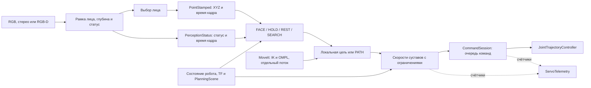

# Архитектура и интерфейсы

Этот файл описывает потоки данных, режимы управления и ROS-интерфейсы пакета.

## Термины

- **TF** — дерево преобразований между системами координат. Каждая точка имеет
  систему координат и время измерения.
- **`stamp`** — временная метка исходного кадра или измерения. **`frame_id`** — имя
  системы координат, в которой задана точка.
- **RGB-D** — изображение цвета и синхронное изображение глубины.
- **interlock** — условие, которое запрещает движение, если данные или состояние
  робота не прошли проверку.
- **FACE** — режим, в котором контроллер стремится направить экран на выбранное лицо.
- **HOLD** — режим без команды слежения. Контроллер выбирает его, если входные
  данные ошибочны, не прошли проверку или устарели.
- **REST** — возврат к настроенной позе отдыха.
- **SEARCH** — движение поиска лица после заданной задержки.
- **QP** — задача квадратичного программирования. В этом пакете она рассчитывает
  скорости суставов с приоритетами и ограничениями.
- **MoveIt** — библиотека планирования движения. **IK** — обратная кинематика:
  расчёт позы суставов для заданного положения инструмента. **OMPL** — набор
  алгоритмов поиска пути.
- **PlanningScene** — модель робота и препятствий, которую MoveIt использует для
  проверки столкновений. **FCL** — библиотека проверки столкновений.
- **SRDF** — описание групп суставов и именованных поз робота. **Reduced Mode** —
  режим робота с уменьшенными пределами скорости. **TCP** — точка инструмента.
- **JTC** — `JointTrajectoryController`, контроллер `ros2_control`, который
  исполняет суставные траектории.
- **PATH** — принятая суставная траектория компактной перестройки.

## Поток данных

Узел обработки камеры находит лица, оценивает точку в 3D и публикует состояние
источника. Обычная камера оценивает расстояние по ширине рамки. Стереокамера
использует разницу положения лица в двух изображениях. RGB-D режим получает
расстояние из depth-изображения. Выбранная точка публикуется в метрах.

Преобразование TF выполняется для времени исходного кадра. Связанные данные
сопоставляются по `stamp` и `frame_id`. Просроченные точки отбрасываются.

В режимах с interlock исправные статусы — только `OK` и `NO_FACE`. При `NO_FACE`
контроллер может кратко использовать прогноз от последнего измерения. Прогноз
сохраняет исходный `stamp` и не продлевает срок измерения. Ошибка глубины,
синхронизации, TF, источника или устаревший статус сразу переводят управление
в HOLD. После срока прогноза контроллер ждёт заданную задержку. Затем он выбирает
REST или SEARCH по `tracking.idle_behavior`. Отдельный watchdog проверяет поток
команд. Время команды не заменяет время измерения лица.

## Режим FACE и компактная перестройка

Управляющий цикл рассчитывает движение каждые 10 мс. В FACE контроллер стремится
направить нормаль экрана на лицо и удерживать верхнюю сторону экрана вертикально.
Он может наклонить экран вслед за высотой лица. Положение экрана и расстояние до
лица имеют меньший приоритет. Ограничения и возможности руки могут не позволить
достичь цели. Поэтому FACE не гарантирует точное наведение в любой позе.

Если свежая FACE-команда отклонена только из-за armed guard крена, после двух
проверенных смешанных команд выполняется одна коррекция по горизонтальному ребру.
Она сохраняет ограничения суставов и столкновений, а команда и полный тормозной
хвост проходят обычную проверку. Такая публикация отводит экран от края, но не
считается успешным наведением FACE.

У xArm6 рабочий край J1 удерживает сустав у этого края. Поворот может продолжаться
через J4. Реверс цели остаётся обычным FACE-слежением. Один лишь малый запас
сустава или ошибка наведения не запускают компактную перестройку.

Компактный маршрут восстанавливает полезный поворот пары J1/J4. Подготовка
учитывает направление требуемого поворота, влияние обоих суставов на наведение,
вертикальность экрана и запас после торможения. Контроллер не складывает остатки
углов J1 и J4 напрямую. Если хотя бы один сустав ещё даёт полезный поворот в
нужную сторону, режим FACE продолжается. Ограничение другого сустава само по себе
не является причиной перестройки.

Перед подготовкой контроллер выполняет пробу QP. Проба проверяет небольшой yaw
поворот за условную секунду при нулевых начальных скоростях и ускорениях. Она
сохраняет вертикальное наведение и ограничивает изменение каждого сустава 10°.
Контроллер сравнивает результат с текущими границами и с расчётным запасом только
в исчерпанных направлениях J1/J4. Проба не посылает команду роботу. Она нужна,
чтобы подтвердить полезный поворот в нужную сторону.

В обеих пробах допустимое изменение крена ограничено оставшимся запасом до
предела ребра. Возле края нельзя засчитать поворот, который выйдет за этот
предел. Конечная поза дополнительно проверяется прямой кинематикой; неудачная
проверка не доказывает, что причиной нехватки движения стали именно J1/J4.

Пока MoveIt строит путь, контроллер продолжает допустимое FACE-слежение. Перед
принятием пути он ещё раз проверяет потребность в перестройке и текущее состояние.
Если запас J1/J4 восстановился или изменилась цель, подготовка отменяется.
Исполняемый путь начинается от конца опубликованной очереди команд. Планировщик
может соединить это состояние с ближайшей проверенной точкой пути. Такие
соединения проверяются отдельно. Для фонового пути планировщик проецирует
состояние на ближайший отрезок и ищет точки вперёд до расстояния не меньше
длины lookahead. Он сохраняет порядок точек пути. Геометрия и пределы скорости
остальной части пути остаются проверенными. Проверка столкновений действует,
пока версия сцены не изменилась.

Компактная перестройка действует только после принятия PATH. Пока PATH исполняется,
его цель закреплена. Остановка цели, реверс или возврат лица не меняют эту цель.
Если сцена изменилась, планировщик может пересчитать путь к прежней цели. Номер
перестройки и цель при этом сохраняются. При отказе кандидатов путь не принимается,
а FACE не отключается.

Для xArm6 компактная зона имеет радиус 0,40 м от оси основания. Радиус учитывает
всю сборку, включая экран, а не только TCP. При входе из широкой позы контроллер
один раз фиксирует больший начальный предел: максимум из 0,40 м, фактической
позы, командной позы и уже опубликованного движения до подтверждённой остановки.
После входа в компактную зону предел становится 0,40 м до конца перестройки.

Предел наклона нормали экрана в PATH остаётся неизменным. Он равен максимуму из
30°, наклона цели и наклона фактической, командной и опубликованной поз до
подтверждённой остановки. Проверка пути и тормозного хвоста использует тот же
предел. При возврате к лицу наклон снова зависит от высоты лица.

В PATH ограничение гравитационного крена экрана равно 5,1°. Планировщик может
использовать весь этот запас. Путь у границы может оставить мало резерва для
фактического слежения. Ограничение при исполнении не ослабляется.

Для xArm6 цель берётся из именованной позы SRDF. `hardware.yaml` может задать
другую цель в `compact_maneuver.goal_joints_rad`: ровно шесть углов в радианах,
в порядке J1–J6. Загрузчик проверяет углы по заводским границам выбранной модели.
Он не проверяет эту цель по активным ограничениям Reduced Mode. Проверка углов
также не заменяет планирование и проверку пути.

Без пользовательского override xArm6 выбирает одну из двух стандартных поз кисти.
Он выбирает допустимый эквивалент цели J6, который меньше меняет свежий измеренный
угол J6. При равенстве выбирается проверенная положительная ветвь. Фактический
угол сустава не оборачивается. Если один путь не найден, контроллер пробует другие
допустимые варианты тех же поз. Повторный отказ из той же позы и сцены не запускается
каждые 10 мс. Проверенный соединительный путь применим только к стандартным целям
при совпадении модели, профиля и отпечатка конечной позы. Другие цели планируются
обычным способом. Явно заданная пользователем цель не меняется.

Параметр `compact_maneuver.speed_scale` доступен в аппаратном и симуляционном YAML.
По умолчанию он равен `1.0`. В PATH он меняет скорость движения вдоль пути и предел
скорости; коррекция отклонения от пути сохраняет усиление `6`. У реального угла
запрос скорости вдоль пути ограничивается усилением коррекции, а подвод к концу
замедляется по оставшейся длине. Это настройка reference, а не сертификат безопасности:
проверки команды, тормозного хвоста, геометрии и столкновений остаются независимыми.
На последнем участке к цели масштабируются усиление и предел скорости. FACE, REST,
SEARCH и возврат к лицу не масштабируются. Для Lite6 проверенной компактной позы SRDF
пока нет. Поэтому запрос перестройки без подходящей цели отклоняется.

После достижения компактной позы контроллер проверяет фактические углы и скорость.
Он также проверяет скорость и ускорение хвоста очереди команд. Если лицо доступно,
возврат сначала делает крен первичной задачей, а наведение на лицо — вторичной.
Перенос экрана на этом этапе не добавляется. Возврат рассчитывает ошибки yaw и
наклона, а также аналитические якобианы нормали экрана и линии взгляда. У полюса,
где направление yaw неоднозначно, контроллер использует последние строки полной
задачи FACE. Когда фактическая нормаль и крен наведены с ошибкой не более 5°,
контроллер возвращается к полной задаче FACE.
Переход требует 0,30 с непрерывных опубликованных команд, допустимого фактического
наведения и безопасного прогноза. Неудачная публикация, потеря наведения,
опасный прогноз или разрыв измерений сбрасывают это время. Если свежего лица нет,
контроллер выбирает REST или SEARCH согласно конфигурации.

В FACE и возврате к нему крен определяется горизонтальным ребром экрана:
`h = R.col(1)`, `u = R.col(2)` в `monitor_control_frame`;
`abs(h.z) <= sin(5,1°)` и `u.z >= 0`. Это ограничение высоты ребра, а не
прежний угол вращения относительно проекции мирового верха. QP использует
производную `h.z` по суставам; синус порога вычисляется заранее. Компактный
PATH сохраняет свой прежний gravity-roll, pitch и радиус.

Допуск FACE по ребру ещё не означает готовность к компактному пути. При
подтверждённом исчерпании хода, если текущая командная поза не проходит прежний
compact-roll, `COMPACT_UPRIGHT_START` сначала выравнивает её без наведения на лицо.
Задача и её якобиан считаются от состояния команды, используемого QP; свежие
фактические данные остаются обязательными. Проверки ребра и полного тормозного
хвоста действуют и здесь. Перед отправкой или приёмом пути повторно проверяются
фактическая поза, очередь и оставшаяся часть опубликованных команд. Недоступная
метрика означает ожидание с проверенным торможением, а не расширение допуска.

В FACE жёсткое ограничение крена можно включить только после проверки фактической
позы и истории отправленных команд до подтверждённой остановки. Если команд ещё
не было, контроллер требует свежую согласованную позу в покое. Неполная история
движущихся команд не подходит. После включения ограничения контроллер проверяет
новую команду и её тормозной хвост. При переходе в REST или SEARCH подтверждение
сбрасывается. Возврат из этих режимов требует новой проверки.

REST-путь проверяет правило ребра при поиске и на промежуточных позах.
Для REST-запроса с этим ограничением внутренний планировщик использует бюджет
поиска 2 с и диапазон RRTConnect 0,30 рад; эти настройки не меняют пределы
состояния или проверку пути. Бюджет относится к поиску OMPL, а не к полному
времени фоновой работы: копирование состояния и проверка найденного пути могут
занять дополнительное время.
Если исходная остановленная поза ещё вне допуска, `REST_UPRIGHT_START` сначала
выравнивает экран существующей QP-задачей. В этой фазе каждый новый шаг и весь
тормозной хвост сохраняют верх экрана сверху и не увеличивают наклон ребра
относительно предыдущей точки. После входа в допуск выход из него запрещён.
Неподвижность нужна для начала выравнивания, а не на каждом его такте.
Ограничения суставов и столкновений действуют на протяжении перехода.

## Ограничения команд и торможение

QP ограничивает скорость, ускорение, рывок, углы суставов и расстояние до препятствий.
Контроллер проверяет новую команду и её тормозной хвост. Тормозной хвост проверяется
по геометрии или дискретно на участках без такой сертификации. Проверка столкновений
учитывает пары тел робота.

Вне активного компактного манёвра отказ проверки ориентации ещё не обязательно
останавливает слежение. Контроллер сначала получает полностью проверенную
тормозную команду из того же состояния. Затем допускаются две пробы между ней
и исходной скоростью слежения: с долей слежения 1/2 и 1/4. Каждая заново проходит
все жёсткие строки, q/v/a/j, геометрию и полный тормозной хвост. При неуспехе
остаётся тормозная команда. Обычный успешный расчёт этих проб не выполняет;
пределы и настройки QP не меняются. Прогноз наведения использует фактически
принятую скорость, а не скорость отвергнутого решения.

Если расчёт не укладывается в срок, кандидатная команда отбрасывается. Восстановление
может продолжить только точную следующую точку уже опубликованной траектории. Для
этого нужны свежая FACE- или REST-цель того же режима и поколения, исправная обратная
связь, неизменная проверенная сцена и достаточный запас времени. Точка не
пересчитывается. При успешном продолжении соответствующий FACE/REST-путь остаётся
активен; если продолжение недоступно, путь снимается, движение останавливается и
контроллер привязывается к обратной связи. На следующем такте контроллер снова
рассчитывает и проверяет команду. Счётчик
`published_brake_continuation_count` показывает такие продолжения.

Для возврата к позе, поиска и смены позы MoveIt строит геометрический путь в отдельном
потоке. Этот путь проходит через тот же исполнитель и очередь команд, что и FACE.
Если у принятого компактного пути не проходит только проверка полного тормозного
хвоста, контроллер сохраняет путь, выполняет проверенное торможение и проверяет
путь снова на следующих тактах. Другие причины отказа снимают путь.

Фактическое ускорение суставов не измеряется. Нулевое поле обратной связи не считается
измерением. Аппаратный STOP, устаревшая обратная связь, опасное движение и нарушение
жёстких ограничений остаются отдельными защитными условиями.

## Границы модулей

| Модуль | Ответственность |
| --- | --- |
| `python/face_tracking_perception/detectors.py` | Запуск YuNet/ONNX и рамки лица в пикселях |
| `depth_geometry.py`, `depth_backends.py`, `rectification.py` | Геометрия камеры, оценка глубины и выравнивание изображений |
| `face_selection.py` | Подтверждение наблюдений, сопоставление положений и выбор лица |
| `node.py`, `depth_node.py` | ROS-изображения, синхронизация, TF, точки и диагностика |
| `python/face_tracking_bringup/` | Проверка конфигурации и запуск оборудования |
| `simulation_config.py`, `simulation_launch.py` | Описание симуляции и запуск Gazebo; отдельный hand-eye запуск использует RGB-D, JTC и MoveGroup без узлов слежения |
| `robot_profile.py`, `hardware_probe.py` | Профиль руки, Reduced Mode и проверка выбранных поз |
| `camera_controls.py` | Настройка USB-камеры и чтение её параметров перед захватом |
| `tracking_core.*`, `face_tracking_component.cpp` | Режимы слежения, входные точки и готовность ROS-контракта |
| `motion_reference.*`, `idle_search.*` | Выбор локальной цели или пути, смена режима и поиск |
| `tracking_velocity_task.*`, `target_motion_estimator.*` | Задача слежения и оценка движения лица |
| `background_path_planner.*`, `joint_path_follower.*` | Планирование MoveIt в фоне и движение по суставному пути |
| `hierarchical_velocity_qp.*` | Расчёт скоростей суставов с приоритетами задач |
| `collision_constraints.cpp`, `collision_stopping.*` | Ограничения столкновений и торможение |
| `collision_validation.cpp`, `collision_distance_query.*` | Проверка поз и траекторий через MoveIt/FCL |
| `robot_geometry_bounds.cpp` | Запасы для геометрии руки и крепления |
| `emergency_brake_tail.*`, `control_time_grid.*`, `published_trajectory_history.*` | Тормозной участок, временная сетка и история опубликованных команд |
| `command_session.*` | Очередь команд, подтверждение запуска и сроки восстановления |
| `servo_telemetry.*` | Сбор измерений и счётчиков; модуль не выбирает движение |
| `collision_aware_servo_*` | ROS-ввод/вывод, цикл управления и соединение модулей |
| `hardware_monitor.py`, `hardware_monitor_gate.py` | Проверка активной руки и параметров Reduced Mode; gate ждёт готовности monitor |
| `docker/host.py`, `docker/runtime.py` | Передача файлов и устройств в Docker, калибровка и запуск |

Состояние очереди и телеметрии принадлежит управляющему потоку. ROS-callbacks
передают свежие данные через mutex и atomics. Диагностика не меняет очередь.
Восстановление `CommandSession` удаляет неопубликованную ветку и сохраняет уже
отправленное торможение. Заголовки в `src/` — внутренние интерфейсы, а не публичный
API пакета.

При остановке контейнер прекращает ROS-callbacks. Компонент присоединяет рабочие
потоки и освобождает MoveIt до закрытия ROS-контекста. Затем контейнер выгружает
компоненты.

## Основные ROS-интерфейсы

| Интерфейс | Тип и назначение |
| --- | --- |
| `/face/center` | `geometry_msgs/PointStamped`: точка выбранного лица в метрах и исходный `stamp` |
| `/face/perception_status` | `face_tracking_arm/msg/PerceptionStatus`: состояние обработки, причина и метки времени |
| `/servo_node/tracking_target_cmds` | `face_tracking_arm/msg/TrackingTarget`: режим, цель, лицо и время измерения |
| `/servo_node/pose_target_cmds` | `geometry_msgs/PoseStamped`: совместимый вход позы |
| `/lite6_arm_controller/joint_trajectory` | `trajectory_msgs/JointTrajectory`: команды суставам |
| `/lite6_arm_controller/controller_state` | Обратная связь `JointTrajectoryController` |
| `/tracking/diagnostics` | Готовность, режим и принятые или отклонённые цели |
| `/servo_node/diagnostics` | Время цикла, ограничения, торможение и события компактной перестройки |
| `/face_test/depth_status` | Число лиц, качество точки, выбранная цель и возраст кадра |

Имя `/lite6_arm_controller` сохранено для совместимости. Оно используется и с xArm6.
Это имя не выбирает модель руки.

### События компактной перестройки

Все события передаются в `/servo_node/diagnostics`. Новый topic или ROS message
для них не добавляется. В `DiagnosticStatus.values` события представлены
индексированными JSON-полями `compact_event_000`, `compact_event_001` и далее.

- Буфер хранит не более 64 событий.
- `compact_event_count` задаёт число событий в текущем сообщении.
- `compact_event_overflow_count` считает потерянные события. Если счётчик растёт,
  журнал неполон.
- Каждое событие содержит `stamp_ns`, `generation_id`, имя события и, если есть,
  причину или `details`.
- `path_started` публикуется один раз, когда принятое поколение пути начинает
  фактически исполняться. Повторное принятие после re-arm не дублирует событие.
- `triggered` содержит причину запуска и значения применённых пределов.

Диагностика также показывает фазу, поколение, удержание J1, достигнутую цель,
предел радиуса и наклона, остановку у компактной цели и переход к полной задаче
FACE. Максимум крена пути неизвестен до принятия пути.

### Контракт цели и статуса perception

В `TrackingTarget` флаг `allow_recovery` разрешает завершить уже принятый
компактный путь или путь возврата после подтверждённой потери лица. Флаг сам по себе
не запускает перестройку. Если лицо отсутствует, принятый путь использует измеренные
углы суставов и не создаёт фиктивную точку лица.

Поля `target_id`, `face_is_prediction` и `face_prediction_expiry` задают поколение
цели и срок прогноза. Прогноз сохраняет исходный `stamp`. Исполнитель проверяет
свежесть измерения при получении команды и на каждом такте. Он также проверяет срок
прогноза. Поэтому последняя команда перестаёт управлять рукой после истечения
срока, даже если новых сообщений нет. Отдельный жёсткий предел возраста действует
для измеренного лица. HOLD, пауза и отсутствие свежих команд не разрешают завершать
путь.

`PerceptionStatus` различает исправный `OK` и здоровый `NO_FACE` от ошибок
`WAIT`, `FACE_NO_DEPTH`, `DEPTH_STREAM_LOST`, `SYNC_ERROR`, `INVALID_INPUT` и
`TF_UNAVAILABLE`. Сообщение содержит причину, время публикации и исходный `stamp`.
При включённом interlock ошибка, устаревший статус или недопустимый capture stamp
переводят управление в HOLD. Они не запускают поиск или восстановление. Прогноз
разрешён только для здорового `NO_FACE` и сохраняет исходный `stamp`. Новое
поколение выбранной цели сбрасывает оценку её скорости.

### Аппаратный monitor

До запуска контроллера preflight проверяет заданные позы. После запуска monitor
сравнивает свежие `RobotMsg` и read-only SDK-опросы с исходным снимком. Он проверяет
режим и состояние руки, ошибки, тормоза, разрешение суставов и Reduced Mode.

При подтверждённой неисправности monitor запрашивает `state=4` только если отчёт
свежий, ошибок нет, оси активны, тормоза отпущены и сервис доступен. Затем он ждёт
ограниченное время подтверждения и завершается с ненулевым кодом. Monitor не
сбрасывает ошибки и не включает приводы повторно. Gate запускает следующие узлы
только после готовности monitor. Таймаут или ненулевой код обязательного узла
останавливает launch.

Monitor не может надёжно обнаружить чужую команду Servo в том же режиме. Поле
`cmdnum` не является счётчиком такой команды. Подробности приведены в
[руководстве по оборудованию](hardware.md).

Узлы симуляции используют `use_sim_time`. Аппаратные узлы используют системное
время. Оси камеры и единицы измерения описаны в
[руководстве по камерам](cameras.md).

## Конфигурация движения

Для оборудования используется [config/hardware.yaml](../config/hardware.yaml).
Основные файлы симуляции и контроллера:

| Файл | Назначение |
| --- | --- |
| `config/tracking.yaml` | Желаемое расстояние, рабочая область, таймауты и TF |
| `config/moveit/collision_aware_servo.yaml` | Задача наведения, цикл, очередь, поиск и планирование |
| `config/moveit/servo.yaml` | Topics, задержка и PlanningSceneMonitor стандартного MoveIt Servo |
| `config/moveit/joint_limits.yaml` | Рабочие пределы скорости, ускорения и рывка |
| `config/control/controllers.yaml` | Контроллеры `ros2_control` |

Некоторые параметры сохраняются для совместимости:

- Внешний `hardware.yaml` может задать шесть углов компактной цели в
  `compact_maneuver.goal_joints_rad`. Углы задаются в радианах, в порядке J1–J6.
  Загрузчик проверяет заводские границы модели. Аппаратный preflight не проверяет
  этот override по Reduced Mode. Он проверяет текущую позу, REST и при необходимости
  SEARCH. Планировщик отдельно проверяет путь. Для применения YAML достаточно
  перезапустить запуск; пересборка Docker-образа не нужна.
- `compact_maneuver.speed_scale` по умолчанию равен `1.0`. Он меняет скорость только
  в PATH и на последнем участке к компактной цели.
- Параметры `moveit_servo.*` сохраняют топики и настройки стандартного MoveIt Servo.
  Собственный `collision_aware` использует только часть этих параметров. Остальные
  старые launch overrides принимаются, но не меняют движение.
- `monitor_near_distance_lipschitz_m_per_rad` оставлен для старых YAML и игнорируется.
  Коэффициент рассчитывается по геометрии руки.
- `tracking.rest_position_m` задаёт позу REST для стандартного MoveIt Servo. Для
  `collision_aware` поза REST задаётся суставами в `motion.rest_joints_deg`.
- Параметры `joint_centering_*`, `collision_avoidance_*`,
  `lower_singularity_threshold`, `hard_stop_singularity_threshold`,
  `singularity_recovery_gain` и `singularity_gradient_step_rad` принимаются
  `collision_aware` для совместимости. Они не меняют движение. При явном задании
  контроллер выдаёт предупреждение. Ограничения суставов и столкновений остаются.
- Параметры сингулярности в `config/moveit/servo.yaml` действуют при
  `servo_backend:=standard`. Этот backend нужен для сравнения. Основные сценарии
  используют `collision_aware`.
- Имя `secondary_roll_weight` сохранено. В FACE оно задаёт вес выравнивания
  горизонтального ребра экрана в первичной задаче вместе с наведением по двум осям.
  При настроенной камере наведение считается в оптическом кадре. Положение TCP
  остаётся вторичной задачей. В режимах без лица действует прежняя иерархия.
- `primary_orientation_tolerance_radps` задаёт допустимое изменение решённой
  первичной скорости на втором шаге QP. Значение `0.0002` помогает сохранить малую
  jerk-limited коррекцию крена. Имя параметра сохранено; для строки ребра
  величина относится к скорости `h.z` (1/с), для угловых строк — к рад/с.
  Это не допуск точности наведения.
- Ключи `condition_number`, `maximum_condition_number`, `singularity_guidance_*`,
  `singularity_gradient_norm`, `task_failure_count` и
  `rearm_budget_exhaustion_count` публикуются как `unavailable`. Контроллер их
  сейчас не рассчитывает.

## Кинематика и ограничения

Заводские ограничения xArm6 и Lite6 сохраняются. Угол сустава не оборачивается на
полный оборот. Значения, отличающиеся на 2π, соответствуют разным физическим позам.
Долгий обход вокруг основания может потребовать обратного поворота руки.

Для аппаратного запуска профиль модели выбирается по идентификатору и серийному
номеру. Если включён Reduced Mode, его диапазоны пересекаются с диапазонами
профиля. Preflight проверяет текущую позу, REST и при необходимости SEARCH.
SDK `is_joint_limit` проверяет эти конкретные позы. Это не проверка всех углов и
не доказательство безопасности произвольной траектории. Неизвестная модель,
ошибочный диапазон или расхождение проверки блокируют запуск.

Начальные суставные углы берутся из обратной связи. Рабочий отступ задаёт запас
внутри жёстких пределов, но не меняет физический диапазон. Проверка компактной
цели и всего пути использует модель руки и измеренные углы. Диагностика сообщает
режим, фазу, generation, причину и результат перестройки. Фактическое ускорение
суставов не измеряется.

При программном отказе и достоверном исполнении контроллер может продолжить
уже опубликованный проверенный тормозной хвост. Для возобновления требуется
подтверждённое владение остановленной командой и свежая неподвижная обратная связь.
В аппаратном режиме сохраняется доказанная команда `q_hold`: измеренная поза
не подменяет её, особенно у границы представимости float. Симуляционный сброс
к фактической позе остаётся отдельным путём. Первый таймаут ожидания фиксируется
один раз; последующие подтверждения покоя не сбрасываются из-за смены текста
диагностики. Срок ожидания при этом не продлевается.
Сопоставление double-значений обратной связи использует общий допуск 1e-6; строгая
проверка границ SDK float и номинальные ограничения опубликованного тормозного
хвоста остаются без изменений.
Если feedback устарел или состояние небезопасно, исполнитель остаётся
`WAITING_FOR_SAFE_STATE` и продолжает проверку. Аппаратный inhibit блокирует
дальнейшие команды независимо от готовности программного rearm; автоматического
снятия аппаратной ошибки нет. Новый аппаратный контракт по умолчанию выключен,
и исполнитель не принимает аппаратные команды до сборки драйвера, стендовой
проверки STOP и подтверждения измерениями задержек и ошибки исполнения для
выбранной руки; см. [условия аппаратного запуска](hardware.md).

В Docker используется закреплённый драйвер UFACTORY и
[локальный readiness-патч](../docker/patches/xarm-readiness.patch). Патч исключает
вызовы `clean_error` и `clean_warn` при старте. Он добавляет проверки готовности
и отправку STOP при завершении. После смены режима руке требуется START
(`set_state(0)`) согласно
[протоколу UFACTORY](https://docs.ufactory.cc/user_manual/ufactoryStudio/10.motion_mode_and_state.html).
SDK не предоставляет атомарную операцию «проверить и включить». Preflight не
заменяет аварийную остановку или встроенные защиты руки.

Планировщик не гарантирует выход из любой позы. Если путь нарушает пределы суставов,
столкновений, крена или радиуса, контроллер его не принимает. Он не ослабляет эти
ограничения, чтобы сохранить FACE. PlanningScene содержит описанную геометрию руки,
экрана, камеры и стола. Пакет не строит карту предметов по изображению.
