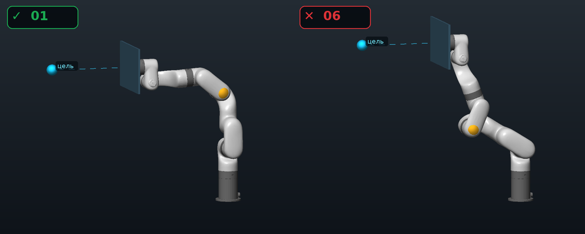
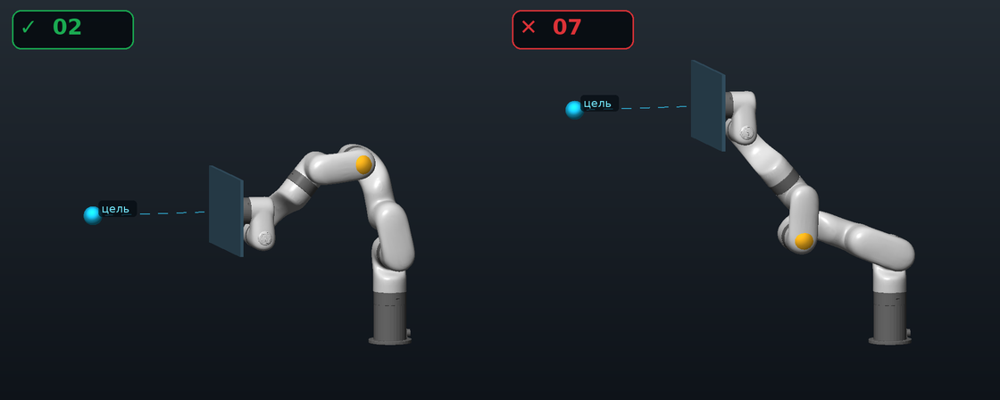
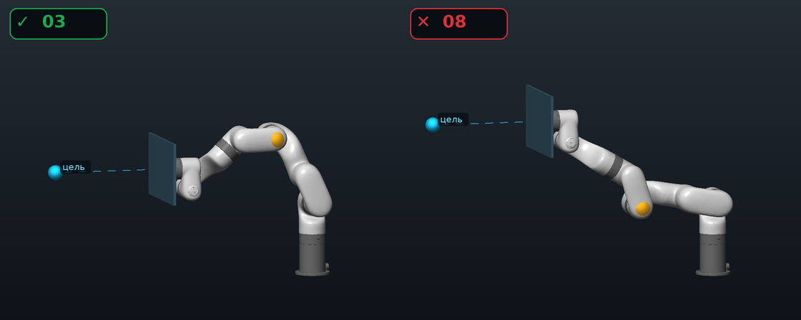
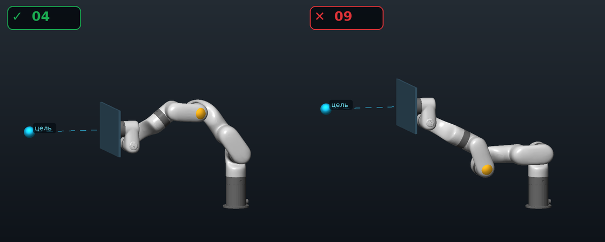
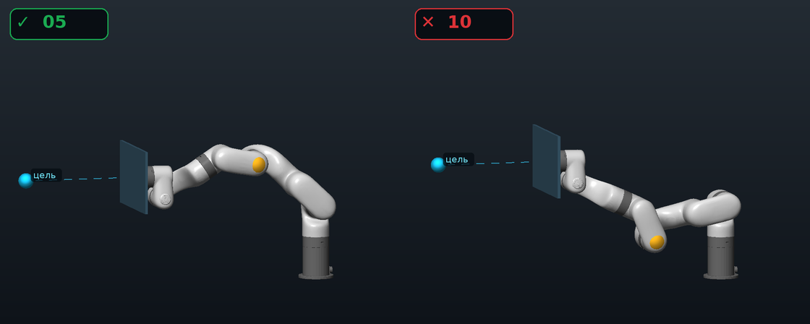
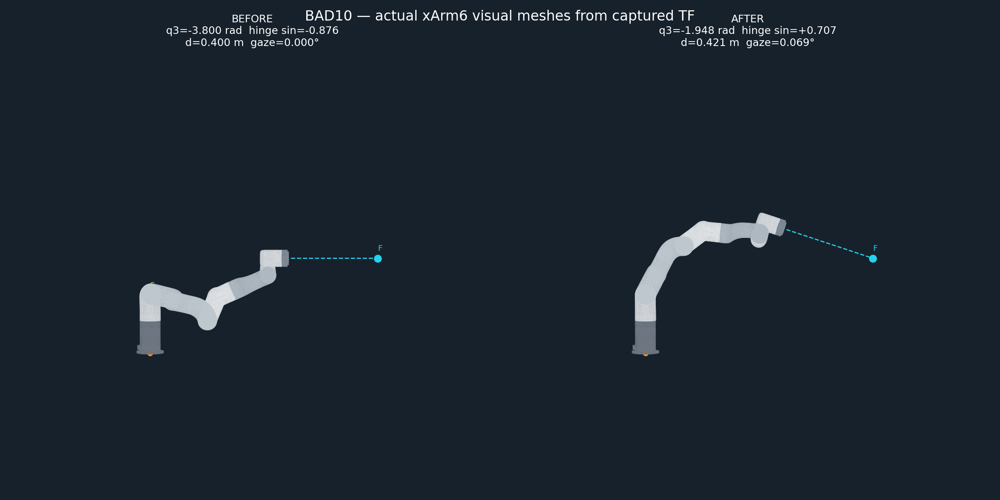

# Согласованные примеры положения локтя — POSTURE-1C

24 октября 2026 пользователь подтвердил: «теперь всё верно» для всех десяти
изображений ниже. Это эталон смысла требования, а не результат проверки
управления. Рендеры построены по фактическим visual meshes и FK модели xArm6.

- **1–5 — правильные позы; 6–10 — неправильные.**
- Жёлтая отметка — локоть, голубая — цель, пунктир — направление экрана.
- Экран направлен на цель во всех примерах. Меняется изгиб основных рычагов.
- Хороший изгиб — назад/от цели относительно основания и запястья;
  плохой — вперёд/к цели. Просто сравнивать высоту локтя и запястья нельзя.
- 25 октября пользователь дополнительно подтвердил: обычную ветвь сгиба,
  как в позах 1–5, предпочитаем при любом направлении цели, пока это совместимо
  со слежением. Сторона относительно цели — дополнительное условие.
- Локоть E — `link3`, запястье W — `link4`. Для оценки стороны используется
  физическое основание B=`link_base`, находящееся ниже плеча S=`link2`.
  Проверка при реализации: B даёт все 10 подтверждённых меток, а замена его
  на S ошибочно объявляет GOOD 2–5 плохими. Предложение такой замены в первом
  плане было технической ошибкой, исправленной по подтверждённым картинкам.
  В мире со столом B.z=0.75; нельзя смешивать мировой F с основанием (0,0,0).

## Как отличаем обычный сгиб

Основной признак — направление сгиба двух рычагов S–E и E–W вокруг оси J3.
Его знак и комфортный диапазон выводятся из штатных поз `rest` и `search`
по кинематической модели. Диапазон допускает разные углы, а не тянет руку
в единственную позу. Почти прямая рука ещё не считается удобным сгибом.

Пока рука вне этого диапазона, предпочтение ведёт J3 к нему; условие стороны
относительно цели в этот момент не конкурирует с выправлением. Внутри диапазона
оно помогает выбрать положение локтя. Оба предпочтения уступают наведению,
восстановлению дистанции и ограничениям безопасности.

Это исправляет недостаток одной только проверки стороны B–W: прежний результат
BAD10 удовлетворял ей, но визуально оставался неправильным. Поэтому приёмка
проверяет фактический сгиб по FK и изображение конечной позы, а не один скаляр.

Точные J1–J6, мировые координаты S/E/W и цели F, а также FK frames сохранены
в [poses.json](reference/posture1c/poses.json). Текстовые метки GOOD/BAD там
соответствуют подтверждённым пользователем оценкам; при обновлении кода их
нельзя пересчитывать из проверяемого алгоритма или менять ради прохождения теста.
`signed_elbow_offset_xz_m` — вспомогательная характеристика именно этих
плоских снимков, не универсальное правило для произвольного положения цели.
`source_urdf` указывает исходный локальный build-файл; тесты должны строить FK
через штатное описание xArm6 проекта, а не зависеть от наличия этого пути.

## Пары для сравнения

## Границы подтверждения

25 октября новый критерий проверен в headless Gazebo: все пять BAD-стартов
достигли обычного комфортного сгиба и удерживали его в конце минимум 11 секунд.
Ниже — реальная начальная и конечная поза №10, восстановленные из записанных
суставов и TF, с visual meshes xArm6. Это результат движения, а не подобранная
вручную финальная поза. Финальная дистанция около 42 см, наведение около 0,07°.

В этих прогонах наблюдались отклонения дистанции примерно на 3 мм от полосы
37–43 см и первичные команды при недоступном вторичном решении. Поэтому они
не означают строгого соблюдения полосы на каждом такте или разрешимости
второго уровня в любой позе. Safety-проверки и наведение продолжали действовать.

Проверены пределы суставов по URDF, FK и направление экрана на цель.
Десять исходных эталонных снимков сами по себе не подтверждают collision clearance, возможность
непрерывного перехода из каждой плохой позы в хорошую при сохранении слежения
или работу контроллера. Такие проверки входят в POSTURE-1C в ROADMAP.

Начальная цель каждого снимка лежит на 0,4 м впереди центра `monitor_link`.
В тесте дистанции использовать настоящий `monitor_control_frame` и его
положение из FK: между этими центрами есть фиксированное смещение.
Во время стационарного теста F фиксируется в world; за экраном не перемещается.
В модельной проверке используются точные F из JSON; демонстрация задаёт
начальные 0,4 м от `monitor_control_frame`, поэтому её F на 5 мм дальше.
Метки поз сохраняются; это различие центров, а не изменение диапазона дистанции.
